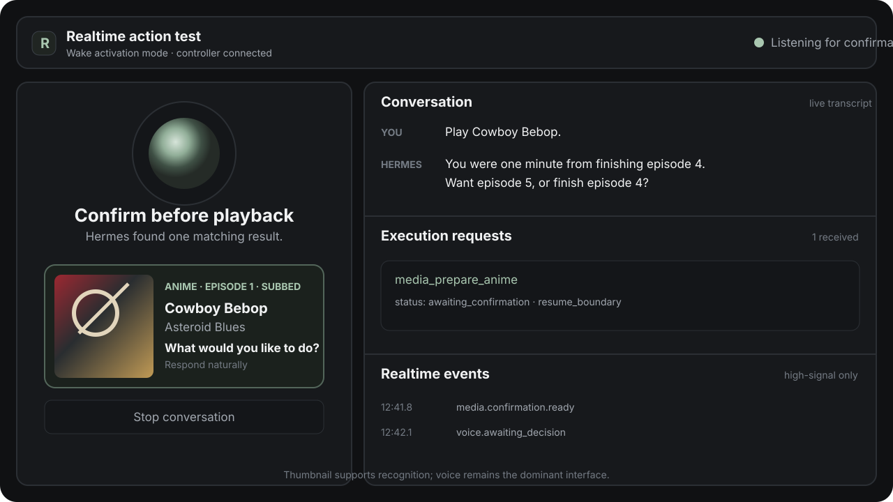
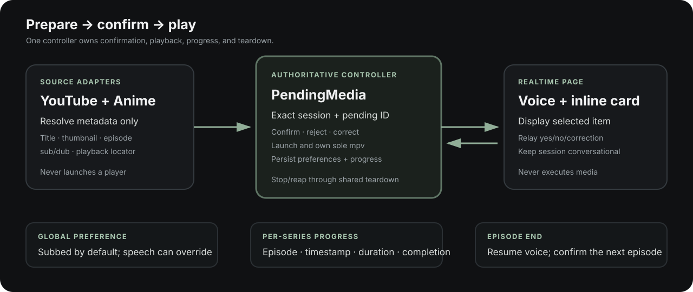

## Decisions at a glance

| Area | Locked decision | Why |
|---|---|---|
| Confirmation UI | Compact inline thumbnail card | The user selected it after comparing rough and high-fidelity A/B previews; media identification improves without displacing the voice interface. |
| Shared flow | Resolve → preview → spoken confirmation → launch | Neither YouTube nor anime opens a player before explicit confirmation. |
| Confirmation language | Natural language, interpreted by the Realtime model | “Yep, that’s it,” “sure, play it,” and equivalent replies confirm without a fixed phrase list. |
| Rejection/revision | Keep listening; accept a correction in the same utterance or ask a follow-up | “No, play the next episode” is one revision turn—not a rejection followed by a separate command. |
| Default episode | Pick up where left off | No history proposes episode 1. Near-complete history proposes the next episode. |
| Resume boundary | Resume only if **more than 5% and more than 90 seconds remain** | Uses both relative and absolute remaining time; avoids resuming into credits or the final minute. |
| Audio mode | One global preference; initial value **subbed** | A spoken “subbed” or “dubbed” overrides the preference for that request. |
| Episode completion | Resume voice and show a next-episode confirmation | No automatic binge loop. |
| Anime backend | Native typed source adapter | Reuses controller-owned playback and avoids terminal-menu automation. |
| Runtime dependency | Do not invoke stock `ani-cli` | Its current interactive menus and self-owned player are not a stable machine contract. Its source remains prior art. |

> **Core invariant:** the Realtime page displays and relays decisions; the controller alone validates the exact pending generation and owns `mpv`.

# Approved inline confirmation



The card contains only information needed to make the decision:

- source type;
- title;
- exact episode and episode title when available;
- subbed/dubbed mode;
- resume timestamp or near-completion explanation;
- a concise open-ended voice prompt such as “What would you like to do?”

Buttons may remain as accessible pointer fallbacks, but voice is authoritative. The card is a view of controller state, not an execution surface.

# Architecture and ownership



## Components

| Component | Owns | Must not own |
|---|---|---|
| YouTube adapter | Search/URL resolution and thumbnail metadata | Confirmation state, `mpv`, teardown |
| Anime adapter | Series search, episode map, language stream, artwork | Voice decisions, `mpv`, global session state |
| Media catalog/service | Unified `PendingMedia`, preference/progress stores, resume proposal | DOM rendering |
| Voice-session controller | Exact session/generation validation, pending-state transitions, player ownership, teardown, completion | Source-specific HTML scraping details |
| Realtime page | Inline card rendering, transcript, bounded control messages | Source resolution, player process creation, durable state |
| `MediaPlaybackManager` | One prepared/playing `mpv` generation, IPC, progress sampling, completion callback | Model-facing tool semantics |

## Shared pending-media contract

Both source adapters produce the same bounded contract before playback:

```text
PendingMedia
  pending_id          opaque local generation ID
  source              youtube | anime
  title               normalized display title
  subtitle            channel, episode title, or context
  thumbnail_url       allowlisted remote image URL
  playback_locator    server-private typed locator
  episode             optional series/season/episode metadata
  audio_mode          sub | dub | not_applicable
  resume              start_seconds, duration_seconds, proposal reason
  prompt               bounded natural-language confirmation prompt
```

`playback_locator` never crosses into model-visible output or arbitrary page execution. The page receives a display-safe projection. Confirmation refers to `pending_id`; it never resubmits an URL selected by the model.

# Voice and state flow

| State | User-visible behavior | Accepted decisions | Controller action |
|---|---|---|---|
| Resolving | Ordinary listening state; brief spoken acknowledgement only if resolution is slow | New request may supersede old request | Cancel/reap stale resolver; retain newest generation |
| Awaiting confirmation | Inline card appears; Hermes names exact item | Any natural-language acceptance, rejection, or revision | Reduce the model’s interpretation to one strict action for the exact pending ID |
| Correcting | Existing card stays until replacement is ready | title/episode/mode correction | Resolve new generation; atomically replace card |
| Playing | Voice input and task turns are suspended under existing media-continuity rules | Player controls only | Controller/player manager owns `mpv` |
| Resuming | Existing exact/reconstructed Realtime continuity path restores voice | Follow-up answer | Persist progress; create contextual follow-up |
| Next-episode confirmation | New inline card proposes next episode | Natural-language acceptance, decline, or alternate episode request | Play only the interpreted exact action |

## Natural-language decision semantics

The voice layer does not maintain a local phrase list for yes/no detection. The Realtime model interprets the utterance in conversational context and calls a strict action tool for the current `pending_id`.

Examples:

| Spoken reply | Interpreted action |
|---|---|
| “Yep, that’s it.” | Accept the current pending item |
| “Sure, play it.” | Accept the current pending item |
| “No, play the next episode.” | Revise to the next episode and prepare a replacement |
| “Actually, episode three dubbed.” | Revise episode and request-local audio mode |
| “That’s not the show I meant.” | Reject selection and ask one focused follow-up |
| “Never mind.” | Cancel the media request while keeping the voice session available |

A plain rejection means “not this selection,” not “close everything.” Hermes asks one short follow-up only when the user has not already supplied corrected criteria:

> “Okay—what should I change: the title, episode, or sub/dub mode?”

If correction is included—“No, play the next episode” or “Actually, episode three dubbed”—the model submits one typed revision action directly. The controller invalidates the old `pending_id` before replacement resolution begins, preventing a late acceptance from launching stale media.

The model may understand varied language, but it cannot invent controller operations. Its output is reduced to `accept`, `reject`, `cancel`, or `revise` with typed optional revision fields. The controller validates that the action refers to the originating live session and current pending generation.

# Resume and completion policy

## Persisted progress

Store one record per canonical anime series:

```text
series_id
series_title
last_episode
position_seconds
 duration_seconds
completed
last_audio_mode_used
updated_at
```

The one global language preference remains separate from per-series progress. An explicit request override does not silently rewrite the global default unless the user explicitly asks to change their preference.

## Deterministic proposal

Given a saved position:

1. Compute `remaining_seconds = max(duration - position, 0)`.
2. Compute `remaining_fraction = remaining_seconds / duration` when duration is valid.
3. Resume the same episode only when both are true:
   - `remaining_fraction > 0.05`; and
   - `remaining_seconds > 90`.
4. Otherwise mark the episode effectively complete and propose the next available episode.
5. At the boundary, say why: “You had one minute left in episode 4. Want episode 5, or finish episode 4?”

The inline card can represent either choice, but the controller records which proposal is active. “Finish episode 4” changes the pending locator to the saved episode/timestamp; “episode 5” confirms the proposed next episode.

## Progress capture

The controller samples `time-pos` and `duration` through the owned `mpv` IPC socket:

- periodically while playing, with a conservative interval such as 15 seconds;
- once on player close/EOF when IPC is still available;
- before intentional teardown where possible.

Writes are atomic and bounded. A failed checkpoint must not orphan `mpv` or block teardown. An EOF completion wins over the last periodic sample.

# Anime source adapter

## Why native, not stock ani-cli

The inspected ani-cli 5.0.2 script:

- searches `anidb.app` HTML;
- reads episode metadata from `/api/frontend/anime/{id}/episodes`;
- resolves language embeds through `/api/frontend/episode/{id}/languages`;
- extracts HLS variants;
- selects through `fzf`/`rofi`/`dmenu`;
- launches its own player and updates its own history.

That is excellent executable prior art but a poor runtime API for Realtime voice. Driving menus or intercepting a custom player would couple correctness to undocumented shell control flow.

## Transport boundary

A live probe found ordinary Python `urllib` received HTTP 403, while argv-only `curl` with the same browser-like user agent used by ani-cli returned HTTP 200 and the expected result HTML. Therefore the first implementation should use a dedicated bounded `CurlAnimeTransport`:

- `asyncio.create_subprocess_exec` only—never a shell string;
- fixed allowlisted `https://anidb.app` and required embed hosts;
- browser-like user agent;
- strict timeout, stdout size cap, terminate/kill/reap behavior;
- no cookies, credentials, arbitrary headers, or model-controlled URLs;
- parsers consume captured bytes and return typed values.

This transport can later be replaced by `httpx` only after a verified anti-bot-compatible path exists. The adapter interface must not expose transport details.

## Resolution sequence

1. Normalize the spoken query and search `anidb.app/browse?q=…`.
2. Parse bounded candidates: canonical ID, title, and poster URL.
3. Select a single candidate deterministically only when confidence is high; otherwise return an ambiguity result for spoken clarification.
4. Read episode IDs and numbers from the frontend episode endpoint.
5. Select explicit episode or derive the resume proposal from local progress.
6. Select `jpn` for sub or `eng` for dub using the global preference/request override.
7. Resolve and validate the HLS stream; choose best quality initially.
8. Return `PendingMedia`. Do not spawn `mpv`.

Artwork uses the source result poster when it passes URL and media checks. Thumbnail failure degrades to a text card; it never blocks confirmation.

# Tool contract

Use preparation tools, not “play immediately” semantics:

```text
media_prepare_youtube(source)
media_prepare_anime(query, episode?, audio_mode=auto)
media_decide(pending_id, action, revision?)
```

`action` is `accept | reject | cancel | revise`. `revision` is accepted only with `revise` and can contain bounded typed changes such as `query`, `episode`, `episode_offset`, and `audio_mode`. For example, “No, play the next episode” becomes `action=revise` with `episode_offset=1`; it is not flattened into a literal “no.”

`audio_mode` is `auto | sub | dub`. `auto` means “read local global preference.” Explicit `sub` or `dub` applies to that request. Preference mutation should be an explicit setting intent—not a side effect of every override.

The controller handles a valid `revise` action by invalidating the old generation and preparing a replacement through the relevant source adapter. `reject` clears the selection and prompts for missing criteria; `cancel` abandons only the media request. Every action remains bounded to the originating local session and current pending ID.

# Failure behavior

| Failure | User experience | Required cleanup |
|---|---|---|
| No search result | Hermes asks for another title | Resolver is reaped; no card/player remains |
| Ambiguous series | Hermes names a short bounded choice set | No player opens |
| Requested episode absent | Card is not shown; Hermes asks for another episode | Pending generation invalidated |
| Preferred language unavailable | Hermes says sub/dub is unavailable and offers the available mode | Never silently switch modes |
| Poster fails | Text-only inline card | Playback remains available |
| Stream resolution blocked/changed | Concise source-unavailable error | Resolver reaped; voice remains live |
| Confirmation timeout | Card clears; Hermes returns to ordinary listening | No player exists |
| Stale confirmation | Ignore/reject exact old pending ID | New pending media remains intact |
| `mpv` launch/IPC failure | Restore voice and report failure | Stop/reap exact process generation |
| Progress write failure | Playback/teardown continues; bounded diagnostic recorded | Never block teardown |
| Episode EOF | Resume exact/reconstructed voice, checkpoint completed, propose next episode | Old player generation is gone before new pending state |
| Tray/service/browser teardown | Terminal shutdown, no next-episode prompt | Controller-owned browser/player/resolvers converge to zero |

# Verification strategy

Implementation follows RED → GREEN in bounded slices.

## Contract tests

- Exact capability allowlist and strict schemas.
- Unknown/stale pending IDs cannot confirm.
- Natural-language paraphrases are model-mediated and produce the same strict `accept` action.
- A compound correction such as “no, play the next episode” produces one `revise` action rather than `reject` plus a later call.
- `reject` and `cancel` leave the voice session live.
- Revision fields are forbidden for non-`revise` actions and bounded by strict schemas.
- Explicit language override does not mutate global preference.
- Global preference persistence is atomic and defaults to subbed.

## Resolver tests

- Fixture HTML/JSON/playlist parsing for search, artwork, episodes, languages, and HLS qualities.
- URL-host allowlists and malformed/control-character rejection.
- Curl argv construction has no shell and no arbitrary target URL.
- Timeout, cancellation, nonzero exit, oversized output, and stubborn-process reaping.
- Ambiguity and missing-language outcomes are typed—not generic parser exceptions.

## Controller tests

- Prepare does not spawn `mpv`.
- Confirming current pending ID spawns exactly one player.
- Rejection and replacement invalidate the old generation.
- Concurrent/duplicate confirmation is idempotent or rejected without a second player.
- Resume threshold tests cover both 5% and 90-second boundaries.
- EOF persists completion before queuing next-episode confirmation.
- Teardown races suppress stale follow-ups.

## Browser contract tests

- Inline card renders escaped text and bounded image URLs.
- Natural-language decisions produce model tool calls/control events but never page-owned player execution.
- Card replacement is atomic; stale card events are ignored.
- Existing exact/reconstructed media continuity, interruption handling, and task-turn suspension remain intact.
- Keyboard/buttons are accessible fallbacks to spoken confirmation.

## Live verification

1. YouTube request → inline preview → “no, find a different video” → replacement → “yep, that’s it” → fullscreen playback.
2. New anime request → episode 1/subbed preview → “sure, play it” → playback.
3. Existing progress with more than 5% and 90 seconds remaining → exact resume proposal.
4. Existing progress with one minute remaining → spoken choice between next episode and finishing current.
5. Natural EOF → voice resumes → next-episode inline confirmation → “play the next one,” “finish this episode,” and natural decline variants tested.
6. Explicit “dubbed” request while global preference remains subbed.
7. Source failure, player close, tray Exit, and controller stop all leave zero owned media processes.

# Scope boundaries

In scope:

- shared inline confirmation for YouTube and anime;
- native anime adapter;
- one global sub/dub preference;
- per-series progress and resume policy;
- next-episode confirmation;
- migration away from YouTube’s current paused-player-as-preview behavior.

Out of scope for this slice:

- browsing a visual anime catalog;
- multiple profiles;
- watchlist synchronization with Crunchyroll/AniList/MAL;
- downloads, batch/range playback, Syncplay, intro skipping, automatic next episode;
- importing or modifying ani-cli history;
- arbitrary player flags controlled by the model;
- treating an unstable scraped source as guaranteed availability.

# Evidence and open risk

Crunchyroll’s public help confirms saved watch progress and manual watched-state controls, but its public documentation did not expose a stable completion threshold. The 5% + 90-second policy is therefore an explicit local product decision, not a claim of Crunchyroll parity.

The major operational risk is source fragility. `anidb.app` is scraped by ani-cli and can change or block clients. The design isolates that risk in one adapter/transport boundary and requires fixture tests plus live smoke probes. If the source becomes unavailable, YouTube and the shared confirmation/player architecture remain unaffected.

# Approval gate

The interaction choices are approved. Before implementation planning, review this document’s controller boundary and tool contract. The recommended shape keeps natural-language interpretation model-mediated through `media_decide`, while the controller receives only a strict action and validates exact IDs before any execution. This preserves conversational freedom without giving the model direct player authority.
